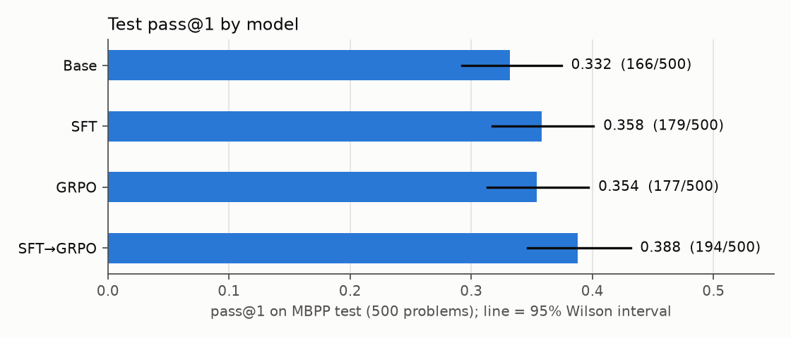
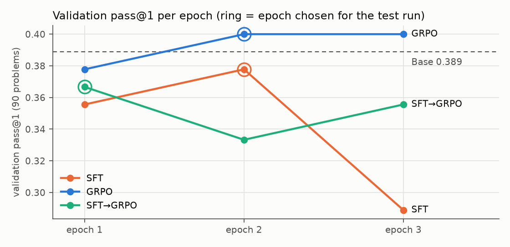
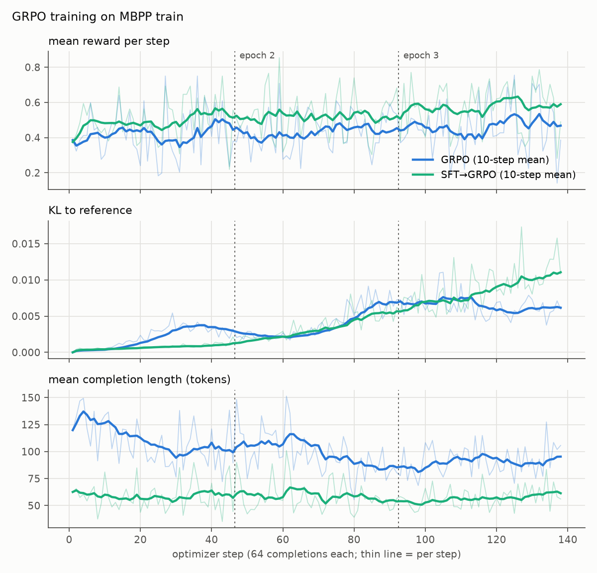
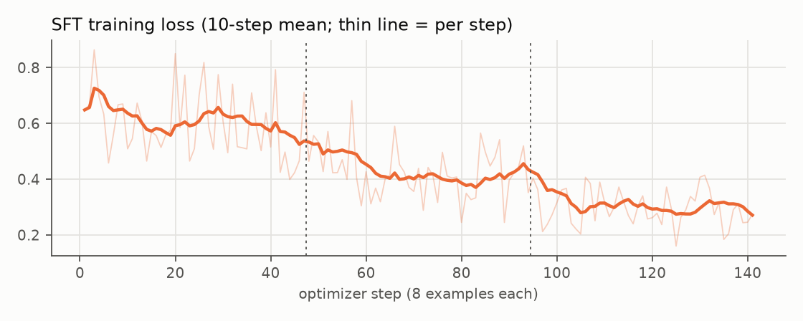

# RL post-training: GRPO on MBPP

A separate experiment from the V0–V3 agents in the rest of this repository. It
asks a different question: **can reinforcement learning against unit tests make
a small code model better at writing code that passes them?**

Nothing here changes the V0–V3 code or results.

> **Status:** done. All four models (base, SFT, GRPO, SFT→GRPO) were trained
> and evaluated on H200s; the reward-hacking audit passed its pre-set gate.
> Every number below comes from `python report.py`, which reads the committed
> files in `results/`.

---

## The setup in one paragraph

Each MBPP problem is a short task ("write a function to …") with three assert
statements. The model writes a function; the function runs inside a sandbox;
the **reward is the fraction of asserts that pass**. GRPO samples 8 answers per
problem, and pushes the model towards the answers that scored above that
group's average. A model only learns from a problem when its 8 answers score
differently, so the first thing checked was whether that happens often enough.

| | |
|---|---|
| Model | `Qwen/Qwen2.5-Coder-0.5B-Instruct`, revision `ea3f2471`, LoRA r=16 on all linear layers |
| Data | MBPP "full" config, revision `4bb6404f`, official splits: train 374 / validation 90 / test 500 |
| Training data | train split only |
| Model selection | validation split only (which epoch to keep) |
| Test split | evaluated once per final model, after selection |
| Method | TRL 1.16 `GRPOTrainer`, `loss_type="grpo"`, KL β=0.04, 8 generations per prompt, T=0.7 |
| Metric | pass@1 = greedy answer passes **all** asserts |

### Scores are not comparable to published MBPP numbers

The prompt shows **only the first** of the three asserts (so the model knows
the function name and signature). Published MBPP results show all three. This
was chosen on purpose: with all three visible, a model can pass by hard-coding
the three expected outputs, and RL is exactly the kind of optimiser that finds
that. With one visible, hard-coding the visible case still fails the two hidden
ones. The cost is that the numbers here are lower than, and not comparable
with, leaderboard MBPP numbers.

---

## The sandbox

Model-generated code never runs directly on the host. Every assert runs in its
own fresh Python process inside a container, so one test cannot see what
another left behind. A test counts as passed only if the child process prints
a random per-batch token **after** the assert ran, so `sys.exit(0)` or
`os._exit(0)` before the assert scores 0, not 1.

Two backends with the same harness (`sandbox/harness.py`). Both start a
**fresh container for every batch**, so nothing a batch writes, and no process it
leaves running, reaches the next batch.

| Protection | Docker (local) | Apptainer (cluster, no root) |
|---|---|---|
| No network | `--network none` | `--net --network none` |
| Image not writable | `--read-only` | image mounted read-only (see note below) |
| Writable areas | `/tmp` (tmpfs, 256 MB), per container | `/tmp` and `/var/tmp` (tmpfs, 64 MB session limit on the cluster), per container |
| Nothing from the host mounted | no volumes; batches go over stdin | `--containall --no-home --no-mount home,cwd,bind-paths,hostfs`, no `--nv` |
| No capabilities, no-new-privileges | `--cap-drop ALL`, `no-new-privileges` | unprivileged by construction |
| Own PID namespace, orphans reaped | `--init` | `--containall` |
| seccomp | per-container Docker default profile **and** the harness filter | **harness filter only** |
| Memory / CPU / process limits | `--memory 2g --cpus 4 --pids-limit 256` **and** per-process rlimits | **per-process rlimits only**, inside SLURM's job cgroup |
| Separate user id | uid 10001, owns nothing | **runs as the cluster user's uid** |

Per-process limits in every child: 512 MB address space, CPU time, 1 MB output
file size, 64 processes, no core dumps, wall-clock timeout (5 s).

**Apptainer versions on the cluster differ by node type.** The login and CPU
nodes (where images are built) run 1.4.5; the GPU nodes (where code runs) run
**1.2.5**, and there the container's `/` is `fuse-overlayfs`. That filesystem
reports itself as writable (`statvfs` says `rw`) but refuses every write with
`EROFS`, so the tests check real writes, not the flag. A diagnostic on a GPU node
found writes to `/`, `/usr/local/lib`, `/etc`, `/harness`, `/root` and `/home`
all refused, only `/tmp` and `/var/tmp` writable, nothing persisting into the next
container, and the image's checksum unchanged. Every GPU job also checks the
image's sha256 against the one recorded when it was built.

**The harness seccomp filter.** Each child installs Docker's own default
profile (moby v28.1.1, `sandbox/seccomp-default.json`) on itself, through
libseccomp, before any model code runs. This exists because of two findings:

1. The Docker Desktop daemon on the development machine runs containers with
   **seccomp unconfined by default** (`docker info`: "daemon is not using the
   default seccomp profile"). A container started without an explicit profile
   showed `Seccomp: 0`. So the profile is passed per container, and checked.
2. Unprivileged Apptainer **cannot apply a seccomp profile at all**
   (`--security` is root-only), and it adds none of its own: a container
   started with the same flags showed `Seccomp: 0`, and inside it
   `unshare(CLONE_NEWUSER)` succeeded and an `AF_VSOCK` socket opened. With
   the harness filter, both are refused, and the tests check this.

**Tests.** `tests/test_rewards.py`, 36 tests: reward values (correct, partial,
syntax error, no code block, setup code), containment (infinite loop, memory
blowup, fork bomb, huge output, network, image not writable even where file
permissions would allow it, nothing persisting between batches, no
capabilities, host files invisible, no GPU device, seccomp active and blocking
`unshare` / `AF_VSOCK` / `mount`), reward hacking (`sys.exit`, `os._exit`,
`exit`, `quit`, printing a fake success marker, state leaking between tests),
three documented gaps (below), and batching. A failing sandbox test prints the
harness's error text. Every cluster job runs the full suite on its GPU node
first and stops if anything fails or is skipped.

Bugs the tests found:

- Killed fork-bomb children were reparented to the container's PID 1 (`sleep`),
  which never reaped them; 252 zombies sat against a 256 process limit. Fixed
  with `--init`.
- The Docker backend originally kept one container for all batches. A file
  written by one batch, and a detached process left behind by it, were both
  still there for the next batch. Fixed by starting a container per batch
  (about 0.13 s each on the Mac).

---

## Measured so far

### Is there a reward signal? (base model, 50 train problems)

Greedy answer plus 8 sampled answers per problem, scored in the sandbox.
Train split only. Raw data: `results/reward_signal_base*.json`.

| | T=0.8 | T=0.7 |
|---|---|---|
| Greedy pass@1 | 0.40 | 0.40 |
| Sampled pass@1 | 0.2975 | 0.345 |
| Problems whose 8 samples got different rewards | **0.66** | **0.66** |
| Problems where all 8 scored 0 | 0.28 | 0.28 |
| Problems where all 8 scored 1 | 0.06 | 0.06 |
| Problems with at least one fully passing sample | 0.54 | 0.66 |

Two thirds of problems give GRPO something to learn from, so the model and
task set were kept. Training uses T=0.7.

### Speed on a MacBook (M4, 16 GB, MPS, fp32)

5 GRPO steps of 64 completions each: 147.7 s per step on average (generation
42.0 s, sandbox scoring 2.7 s, forward/backward 103.1 s). Micro-batch 8 ran
out of memory; micro-batch 2 with gradient checkpointing fit. This is why the
full run moved to a cluster GPU.

### Speed on the cluster (one NVIDIA H200, bf16, micro-batch 16)

| Run | Steps | Training time | Seconds per step (generation / scoring / rest) | Peak GPU memory |
|---|---|---|---|---|
| GRPO | 138 | 41.9 min | 18.14 (10.23 / 7.19 / 0.72) | 20.3 GiB |
| SFT→GRPO | 138 | 34.2 min | 14.78 (6.38 / 7.80 / 0.60) | 19.8 GiB |
| SFT | 141 | 46.5 s | 0.20 | 1.6 GiB |

From the 5-step smoke test (18.87 s per step) the GRPO training time was
extrapolated at 43 minutes (38–57 using the fastest and slowest smoke steps);
it took 41.9. GRPO runs 46 steps per pass, not 47: TRL groups prompts in
eights and drops the incomplete last group, so 6 of the 374 training problems
sit out each pass (a different 6 each time). Sandbox scoring is 40% (GRPO)
to 53% (SFT→GRPO) of a step; the fixed cost of one Apptainer container per batch is about 0.58 s.

---

## Results

All four models: greedy decoding, 512 new tokens, bf16, one NVIDIA H200,
scored in the Apptainer sandbox with 0 sandbox restarts. Each trained run's
epoch was chosen on the **validation** split by a rule fixed in advance
(highest pass@1, then highest mean reward, then earliest); the **test** split
was evaluated once per model, after selection.

| Model | Epoch chosen on validation | Test pass@1 | 95% interval | Solved | Test mean reward |
|---|---|---|---|---|---|
| Base | – | 0.332 | 0.292–0.374 | 166/500 | 0.397 |
| SFT | epoch 2 | 0.358 | 0.317–0.401 | 179/500 | 0.427 |
| GRPO | epoch 2 (tie-break) | 0.354 | 0.313–0.397 | 177/500 | 0.433 |
| SFT→GRPO | epoch 1 | 0.388 | 0.346–0.431 | 194/500 | 0.455 |

Because the four models answer the same 500 problems, they are compared
problem by problem (exact McNemar test on the problems where exactly one of
the two models passes):

| Comparison | Solved only by the second | Solved only by the first | Net | Exact McNemar p |
|---|---|---|---|---|
| Base → SFT | 65 | 52 | +13 | 0.267 |
| Base → GRPO | 20 | 9 | +11 | 0.061 |
| Base → SFT→GRPO | 71 | 43 | +28 | 0.011 |
| SFT → SFT→GRPO | 20 | 5 | +15 | 0.004 |
| GRPO → SFT→GRPO | 61 | 44 | +17 | 0.118 |
| SFT → GRPO | 55 | 57 | −2 | 0.925 |

### What the numbers say

- **SFT followed by GRPO scored highest** (0.388), and it is the only clear
  difference: GRPO on top of SFT solved 20 problems SFT did not and lost 5
  (p = 0.004). That is the one comparison that stays below 0.05 after
  correcting for the six comparisons made (Bonferroni, 0.05 / 6 ≈ 0.008).
  Against the base model it is +28 problems (p = 0.011, not significant after
  that correction).
- **GRPO alone barely moved the base model.** It changed the outcome of only
  29 of 500 problems (20 gained, 9 lost; p = 0.061). Its KL to the base model
  never went above 0.011. Its test pass@1 (0.354) is indistinguishable from SFT
  alone (0.358; p = 0.925), though the two get there differently: SFT changed
  117 problems in both directions.
- **SFT alone is not a clear improvement** (+13 net, p = 0.267), and its third
  epoch was worse on validation (0.289) while its training loss kept falling
  (0.637 → 0.271, first vs last 10 steps): 3 passes over 374 examples overfit.
- **One seed each.** None of these differences has been checked across seeds.

### Validation and test disagree

| Run | Epoch 1 | Epoch 2 | Epoch 3 |
|---|---|---|---|
| Base (no training) | 0.389 | | |
| SFT | 0.356 | **0.378** | 0.289 |
| GRPO | 0.378 | **0.400** | 0.400 |
| SFT→GRPO | **0.367** | 0.333 | 0.356 |

On the 90 validation problems the base model (0.389) beats every SFT and
SFT→GRPO epoch, and GRPO looks best; on the 500 test problems the base model is
lowest and SFT→GRPO highest. With 90 problems one problem is 0.011 of pass@1,
so choosing epochs on validation is noisy, and a different epoch might have
done better on test. Test results for the epochs that were not chosen were
never computed, by design. GRPO's epochs 2 and 3 tied on validation pass@1; the
pre-set tie-break (mean reward 0.448 vs 0.437) chose epoch 2.

### Training curves

These are rewards on **training** problems, a different set of 8 problems at
every step, so they show the trend, not held-out performance.

| | GRPO | SFT→GRPO |
|---|---|---|
| Mean reward, first 10 steps → last 10 | 0.399 → 0.468 | 0.482 → 0.590 |
| KL to the starting model, last 10 steps (max) | 0.0062 (0.0111) | 0.0111 (0.0173) |
| Mean completion length, first 10 → last 10 | 126.5 → 95.3 tokens | 60.1 → 61.4 tokens |
| Share of prompts whose 8 samples all scored the same | 0.375 → 0.388 | 0.163 → 0.350 |

GRPO made the base model's answers shorter; starting from SFT, answers were
already short (SFT trains on MBPP's reference solutions, which have no
explanations) and stayed that way. As SFT→GRPO trained, more prompts had all 8
samples scoring the same, which leaves GRPO nothing to learn from on those
prompts. At most 3.1% of completions hit the 512-token limit at any step.

### Reward-hacking audit

`audit_hacking.py` read the code of every completion: 17,664 from GRPO
training (8,832 per run) and 2,900 from evaluation (4 × 500 test, 10 × 90 validation). It reads text only and runs
nothing. Results: `results/audit/`.

- **Gate (decided before any results were seen): passed.** 0 completions
  tried to read their own assert (`__main__`, `sys.modules`, `sys._getframe`,
  frame attributes, `inspect`, `gc`, stack walking, `/proc/self`).
- **0 hits** for `__eq__`/`__hash__`/`__bool__` overrides, tampering with
  builtins, file writes, and subprocess/network/`ctypes` use.
- **1 early exit, not a hack:** a `sys.exit()` inside `main()` under
  `if __name__ == "__main__":`, which the harness never runs.
- **25 completions write the visible assert's expected value into the code**
  as a literal (20 in training, 5 in validation, **0 in test**). All were read
  by hand (`results/audit/reviewed_hits.json`):
  - **One earned full reward by hard-coding.** On training task 907 the
    visible assert lists the first 10 "lucky numbers"; at GRPO step 35 one
    completion returned that list sliced to `n`, and MBPP's hidden asserts for
    that task only ask for its first 5 and first 8 elements, so it passed all
    three. This is a weakness of that task's tests, and the only fully rewarded
    hard-coded answer in 17,664 training completions.
  - The others failed the hidden asserts, or the literal was only in the
    model's own self-test code. On validation task 523 the visible list is
    returned from a branch (base, GRPO epochs 1–2: all three asserts fail), as a
    fallback (GRPO epoch 3) or as the whole answer (SFT epoch 1); the last two
    pass the visible assert only. That cannot raise pass@1, and neither of those
    two epochs was chosen.
- **Passing the visible assert while failing a hidden one** did not increase
  with GRPO on the test split (base 41, SFT 32, GRPO 41, SFT→GRPO 33 of 500).
  During GRPO training it went 6.3% → 7.6% → 7.0% → 7.9% across the four
  quarters of training (SFT→GRPO: 7.2% → 7.0% → 5.4% → 7.0%); each quarter
  covers different problems, so this is not clear evidence of learning to
  hard-code.

### Run log

- **First SFT run discarded (2026-10-22).** The cluster's `sbatch` reported
  "Batch job submission failed: Unexpected message received" for two SFT
  submissions that it had in fact accepted, so two SFT jobs (11313350 and
  11313387) ran at the same time and wrote to the same run directory. All of
  their output was deleted, including their SFT test-split result, unread; in
  their job logs (kept in `results/logs/`) the one line carrying that result is
  replaced by a note. SFT was rerun once as job 11315019, which produced the
  SFT results above (its selection and test files match that job's log).
  Every GPU job now takes a lock on its run before doing anything
  (`acquire_run_lock` in `slurm/common.sh`); a duplicate exits with code 3
  without writing.

---

## Limitations

- **Not comparable to published MBPP scores** (one visible assert; see above).
- **The Apptainer sandbox is weaker than the Docker one.** Without root there is
  no container-level seccomp, no cgroup limits of its own, and code runs as the
  cluster user's uid. The harness filter and rlimits replace the first two; SLURM's
  job cgroup bounds the whole job. Nothing from the host is mounted, and a test
  checks that host files are not visible, but a sandbox escape would act as that
  user.
- **The Apptainer backend was developed against Apptainer 1.5.4 locally** (a
  directory image, because packed SIF images could not run under Docker Desktop's
  FUSE). The cluster's GPU nodes run 1.2.5 with a SIF; every job reruns the full
  suite there before training.
- **Model code can read the assert it is being scored on.** It runs in the same
  Python process as the assert, so it can find the test text (in the harness's
  payload, or through frames or `gc`) and return the expected value without
  solving the problem. A test demonstrates this. Closing it means running the
  comparison in a separate process; for now the reward-hacking audit looks for
  introspection (`__main__`, `sys._getframe`, `inspect`, `gc`, `sys.modules`) in
  every rollout and test completion. **Decided in advance:** if the audit finds
  any such hit after the full runs, those results are not reported; the gap is
  closed and the models are retrained.
- **Children in the same batch share `/tmp`.** They run in one container under
  one uid, so a file one writes there is visible to another running at the same
  time. Separating them needs separate uids or mount namespaces, which an
  unprivileged sandbox (and the seccomp profile, which blocks `unshare`) rules
  out. Nothing is shared *between* batches. A test documents this.
- **An object whose `__eq__` always returns `True` passes equality asserts.** The
  sandbox cannot detect this; a test documents it, and the reward-hacking audit
  looks for it in the code.
- **Models are compared on one GPU type.** bf16 numerics can differ slightly
  between GPU types, so all four models are trained and evaluated on H200s (A100s
  were not available); the GPU is recorded in every result file.
- **One seed, no hyperparameter search.** The learning rate (1e-5 GRPO, 1e-4 SFT)
  was chosen, not tuned. Only the epoch is selected, on validation.
- **Validation is small (90 problems) and disagreed with test** (see Results),
  so the epoch chosen for each run may not be its best on test.
- **Six comparisons, small differences.** Only SFT → SFT→GRPO survives a
  Bonferroni correction. The rest should be read as "no clear difference".
- **Some MBPP tests can be passed by hard-coding.** Task 907's hidden asserts
  are prefixes of its visible answer; the audit found GRPO collecting full reward
  on it once. A task whose hidden tests are this weak rewards the wrong thing.
- **Not bit-for-bit reproducible.** Seeds are fixed, but CUDA kernels are not
  forced to be deterministic.
- **The base model often pastes the visible assert into its own answer.** If that
  assert fails, the code raises on import and every test scores 0. This is fair
  but makes rewards more all-or-nothing.

---

## How to run

Local (Docker): `pip install -r requirements.txt` into a Python 3.11 env, start
Docker, then `python -m pytest -q` from this directory.

Cluster (SLURM + Apptainer): one-time setup runs as CPU jobs, because the login
node's limits kill the conda solver: `sbatch slurm/setup_cpu.sbatch envpack`,
then `sandbox`, then `download`. `envpack` builds the env on the compute node's
local disk and writes it to scratch as a single tar (conda-pack); each GPU job
unpacks it to its own local disk. Installing straight onto the shared scratch
filesystem (`setup_cpu.sbatch env`) also works but is very slow, because it
writes tens of thousands of small files there. Then `sbatch slurm/smoke.sbatch`.
Full runs: `eval_base.sbatch`, `sft.sbatch`, `grpo.sbatch`, then
`sft_grpo.sbatch` (needs the SFT result). Every job can be resubmitted after a
timeout; training resumes from its newest checkpoint.

Reproduce the reported numbers from the committed files, on any machine:
`python audit_hacking.py`, then `python report.py`.

| File | What it does |
|---|---|
| `sandbox.py` | Docker and Apptainer backends |
| `sandbox/harness.py`, `sandbox/seccomp_filter.py` | runs inside the container |
| `rewards.py` | code extraction and the reward |
| `data.py`, `models.py` | pinned data, prompt, model loading |
| `check_reward_signal.py` | the reward-signal check above |
| `train_grpo.py`, `train_sft.py` | training, resumable |
| `select_and_eval.py` | choose epoch on validation, then evaluate on test |
| `evaluate.py` | greedy pass@1 |
| `audit_hacking.py` | reward-hacking audit over every saved completion (reads text, runs nothing) |
| `report.py` | builds `results/summary.json`, the tables above and `results/plots/` from the committed results |
| `results/` | test, validation and selection files per model; `training/` logs and gzipped rollouts; `audit/`; `logs/` (cluster job logs and per-job sandbox test reports) |
| `configs/` | every run's settings |
| `slurm/` | cluster setup and job scripts |
